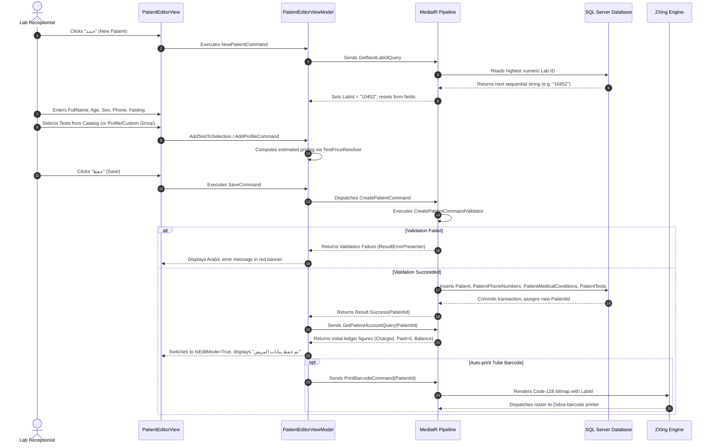
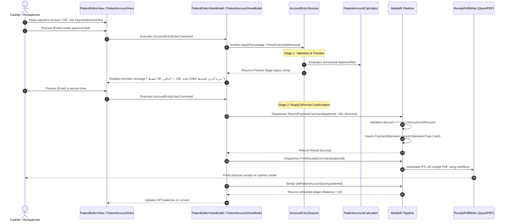
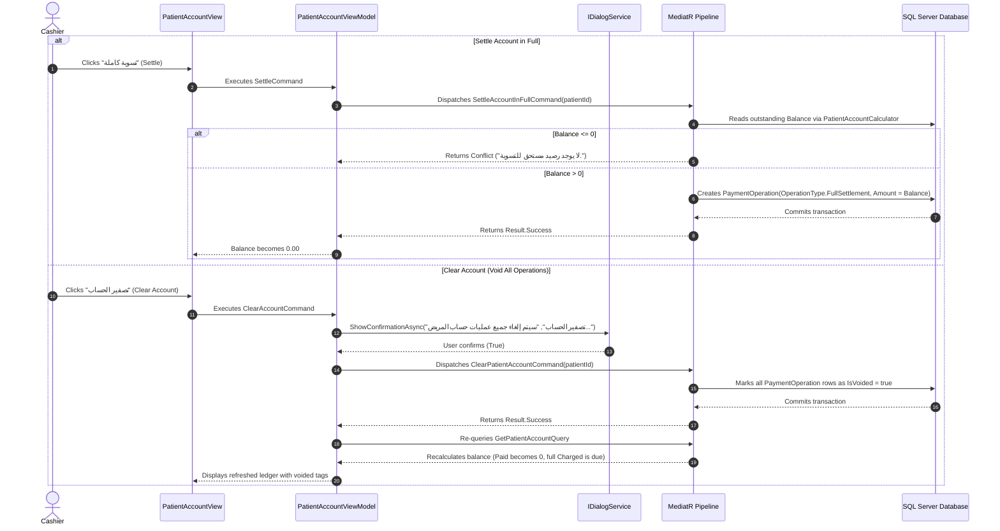

# Top-Lab — Unit 1 Functional Audit & Element Inventory
# Unit 1: Patient Registration and Test Registration

---

## §1 Executive & Technical Overview of Unit 1

### 1.1 Scope & Purpose
**Unit 1: Patient Registration and Test Registration** is the core functional engine and initial ingress point of the Top-Lab Laboratory Information System (LIS). It governs the end-to-end lifecycle of patient demographics intake, visit creation, test/profile/custom group ordering, clinical fasting and medical condition screening, billing/settlement calculations at cashier level, and immediate collateral printing (receipts, Code-128 barcode tube labels, lab orders, and sample envelopes).

The unit spans the primary intake screen (`PatientEditorView`), searchable visit directories (`PatientSearchView`, `PatientVisitHistoryView`), the patient's financial ledger (`PatientAccountView`), and auxiliary modal dialogs (`ExtraChargeDialogWindow`, `CorrectionDialogWindow`, `AmendDialogWindow`, `TestCommentPickerWindow`).

### 1.2 Architectural Foundation & Layering
Unit 1 strictly adheres to Clean Architecture with unidirectional dependencies:

```
TopLab.Presentation (WPF, MVVM, XAML DataBindings)
       │
       ▼
TopLab.Application (MediatR CQRS, FluentValidation, Pipeline Behaviors)
       │
       ▼
TopLab.Domain (Pure Aggregates, Value Objects, Domain Calculators, State Invariants)
       ▲
       │
TopLab.Infrastructure (EF Core 8 / SQL Server, QuestPDF, ZXing.Net Code-128, File Assets)
```

1. **TopLab.Presentation (WPF / XAML):**
   - Built on MVVM pattern using `ViewModelBase`, `AsyncRelayCommand`, and `RelayCommand`.
   - Native RTL (`FlowDirection="RightToLeft"`) layout optimized for dense Arabic desktop operations.
   - Decoupled dialog invocation through `IDialogService` and `IServiceProvider`.
   - UI navigation coordinated by `INavigationService`.

2. **TopLab.Application (CQRS / MediatR):**
   - **Commands:** `CreatePatientCommand`, `UpdatePatientCommand`, `SoftDeletePatientCommand`, `AddTestsToVisitCommand`, `AddProfileToVisitCommand`, `AddCustomGroupToVisitCommand`, `RemoveTestFromVisitCommand`, `ClearAllTestsCommand`, `ApplyVisitDeltasCommand`, `ApplyConditionDeltasCommand`, `UpdatePatientTestSampleFlagsCommand`, `PrintBarcodeCommand`, `RecordPaymentCommand`, `RecordExtraChargeCommand`, `RecordCorrectionCommand`, `RecordRefundCommand`, `SettleAccountInFullCommand`, `ClearPatientAccountCommand`, `VoidPaymentOperationCommand`, `PrintReceiptCommand`, `PrintInvoiceCommand`, `PrintEnvelopeCommand`, `PrintLabOrderCommand`.
   - **Queries:** `SearchPatientsQuery`, `GetPatientByIdQuery`, `GetPatientVisitHistoryQuery`, `GetRegistrationCatalogQuery`, `GetNextLabIdQuery`, `GetPatientTitlesQuery`, `GetMedicalConditionTypesQuery`, `GetPatientAccountQuery`, `GetPatientReceiptQuery`, `GetPatientInvoiceQuery`, `ListPatientPaymentsQuery`, `GetVisitWorkSheetQuery`.
   - **Pipeline Validation:** Auto-scanned FluentValidation validators (`CreatePatientCommandValidator`, `AddTestsToVisitCommandValidator`, `RecordPaymentCommandValidator`, etc.) executing before handlers.
   - **Authorization:** `IAuthorizedRequest` enforcement checking granular permission codes (`ADD_EDIT_PATIENT` = id 1, `DELETE_PATIENT` = id 9, `CASH_DISBURSE_DEPOSIT` = id 11).

3. **TopLab.Domain (Entities & Domain Invariants):**
   - **Core Aggregates & Entities:** `Patient` (visit-level root), `PatientPhoneNumber`, `PatientMedicalCondition`, `PatientTitle`, `MedicalConditionType`, `PatientTest`, `PaymentOperation`, `InvoiceIssue`.
   - **Value Objects & Strongly Typed IDs:** `PatientId`, `LabId`, `ExternalEntityId`, `TestId`, `ProfileId`, `CustomGroupId`, `PaymentOperationId`.
   - **Domain Calculators & State Engines:**
     - `PatientAccountCalculator`: Pure static service implementing `TotalCharged`, `TotalPaid`, `CashRefundable`, and `Balance`.
     - `AccountEntryParser` & `AccountEntrySession`: Two-press interactive Enter engine handling fee calculations, cash discounts, and percentage-based discounts.
     - `TestPriceResolver`: Central 4-branch pricing resolution hierarchy (Contract Price List -> Lab-to-Lab -> Custom Group -> Standard Patient Catalog Price).
     - `PatientStatusCalculator`: Derives aggregate visit state (`PatientAggregateStatus`).
     - `AgeRules`: Normalizes multi-unit age entries (Years, Months, Days) and evaluates pediatric thresholds.

4. **TopLab.Infrastructure (Persistence & Rendering Engine):**
   - **Persistence:** EF Core 8 mapping via `PatientConfiguration`, `PatientTestConfiguration`, and `PaymentOperationConfiguration` against SQL Server. Supports soft delete filters (`IsDeleted`), cascade deletions, and index strategies.
   - **QuestPDF:** High-performance document rendering using HarfBuzzSharp Arabic bidi text shaping (`ArabicFontResolver`) for Cashier Receipts (`ReceiptPdfWriter`), Formal Invoices (`InvoicePdfWriter`), Lab Worksheets (`WorkSheetPdfWriter`), and Envelopes (`EnvelopePdfWriter`).
   - **ZXing.Net:** Generates native Code-128 1-D barcodes (`BarcodeLabelRenderer`, `BarcodeService`, `BarcodePngEncoder`) rendered without UI dependencies.

---

## §2 Functional Hierarchy Tree

```
1. Unit 1: Patient Registration and Test Registration
├── 1.1 Container: PatientEditorView [Unified Registration & Intake Screen]
│   ├── 1.1.1 Block: Top Status & Progress Bar
│   │   └── UI Element: ProgressBar (bound to IsBusy)
│   ├── 1.1.2 Block: Search-to-Edit Section (Quick Patient Search)
│   │   ├── UI Element: SearchTerm TextBox
│   │   ├── Function: SearchPatientsCommand [SearchPatientsQuery]
│   │   │   └── Business Rule: BR-SEARCH-01 (Multi-criteria matching: Name, National ID, Lab ID, any phone)
│   │   ├── Subfunction: ClearSearchCommand
│   │   ├── UI Element: SearchResults ListView
│   │   │   ├── UI Element: IsDeleted text badge
│   │   │   └── Subfunction: OpenSearchResultCommand [GetPatientByIdQuery]
│   │   └── UI Element: Paging Controls (PrevSearchPageCommand, NextSearchPageCommand, SearchPage)
│   ├── 1.1.3 Block: Demographics & Visit Header Block
│   │   ├── UI Element: PatientIdText TextBox (Read-Only System ID)
│   │   ├── UI Element: LabId TextBox
│   │   │   ├── Function: GetNextLabIdQuery
│   │   │   └── Business Rule: BR-LABID-01 (Padded sequential alphanumeric format, uniqueness validation)
│   │   ├── UI Element: RegistrationDateText TextBox (yyyy-MM-dd HH:mm)
│   │   ├── UI Element: PickupDateText TextBox (yyyy-MM-dd HH:mm)
│   │   │   └── Business Rule: BR-DATE-01 (PickupDate must be >= RegistrationDate)
│   │   ├── UI Element: FullName TextBox
│   │   │   └── Business Rule: BR-NAME-01 (Mandatory, max 200 characters)
│   │   ├── UI Element: IsVip CheckBox
│   │   ├── UI Element: Title ComboBox (Editable, bound to Titles catalog)
│   │   ├── UI Element: IsMale CheckBox (Checked = Male, Unchecked = Female)
│   │   ├── UI Element: AgeValue TextBox & AgeUnits ComboBox
│   │   │   └── Business Rule: BR-AGE-01 (AgeValue >= 0, supports Year/Month/Day units)
│   │   ├── UI Element: PhoneNumber TextBox
│   │   │   └── Business Rule: BR-PHONE-01 (Trimmed non-empty string, max 30 chars)
│   │   ├── UI Element: NationalId TextBox (Max 30 chars)
│   │   ├── UI Element: Address TextBox
│   │   ├── UI Element: AccountType ComboBox (Individual, LabToLab, ContractCompany, Insurance, Free)
│   │   ├── UI Element: CardNumber TextBox (Max 30 chars)
│   │   └── UI Element: SampleTypeSummary TextBlock (Live summary of selected sample matrices)
│   ├── 1.1.4 Block: External Referring Entities Block
│   │   ├── UI Element: TreatingDoctorIdText TextBox & TreatingDoctorName TextBlock
│   │   ├── Subfunction: PickTreatingDoctorCommand [Modal: ExternalEntityPickerWindow]
│   │   ├── Subfunction: ShowTreatingDoctorDetailsCommand [Modal: ExternalEntityDetailsWindow]
│   │   ├── UI Element: ReferralEntityIdText TextBox & ReferralEntityName TextBlock
│   │   ├── Subfunction: PickReferralEntityCommand [Modal: ExternalEntityPickerWindow]
│   │   └── Subfunction: ShowReferralEntityDetailsCommand [Modal: ExternalEntityDetailsWindow]
│   ├── 1.1.5 Block: Clinical Fasting, Conditions & Medical History Block
│   │   ├── UI Element: IsFastingIndicated CheckBox
│   │   ├── UI Element: FastingHoursText TextBox
│   │   │   └── Business Rule: BR-FAST-01 (When Fasting=True, FastingHours must be > 0)
│   │   ├── UI Element: MedicationConditions ItemsControl (Dynamic toggles)
│   │   ├── UI Element: RecentContrastImaging CheckBox ("صبغة")
│   │   ├── UI Element: RecentUltrasoundImaging CheckBox ("موجات صوتية")
│   │   │   └── Business Rule: BR-HIST-01 (Imaging within last 48 hours)
│   │   ├── UI Element: ConditionToggles ItemsControl (Dynamic general health conditions)
│   │   └── UI Element: Notes TextBox (Multi-line clinical notes)
│   ├── 1.1.6 Block: Result Delivery Credentials Block
│   │   ├── UI Element: PrintResultPasswordEnabled CheckBox
│   │   ├── UI Element: PrintResultPasswordBox PasswordBox
│   │   └── Function: SavePrintResultPasswordCommand [UpdatePrintResultPasswordCommand]
│   │       └── Scope: OUT OF SCOPE FOR TOP-LAB PARITY (PRD §17.1 Web Portal / Online Delivery)
│   ├── 1.1.7 Block: Visit History Panel (Edit Mode Context)
│   │   ├── UI Element: VisitHistory ItemsControl
│   │   └── UI Element: ShowVisitHistoryEmpty Indicator
│   ├── 1.1.8 Block: Test Catalog & Selection Ordering Block
│   │   ├── Subfunction: Mode Selectors RadioButtons (TM: All Tests, TG: Group/Search, CG: Custom Groups)
│   │   ├── UI Element: CatalogFilterText TextBox & ClearCatalogFilterCommand
│   │   ├── UI Element: FilteredCatalogTests ListView
│   │   │   └── Subfunction: AddTestToSelectionCommand
│   │   ├── Block: Quick Actions Header
│   │   │   ├── UI Element: Profiles ComboBox & AddProfileCommand [AddProfileToVisitCommand]
│   │   │   ├── UI Element: Profile Matrix Flags CheckBoxes (Urine, Stool, Blood, Semen, CSF, Outside Lab)
│   │   │   ├── UI Element: CustomGroups ComboBox & AddCustomGroupCommand [AddCustomGroupToVisitCommand]
│   │   │   └── Function: ClearAllVisitTestsCommand [ClearAllTestsCommand]
│   │   └── UI Element: SelectedTests ListView
│   │       ├── UI Element: RemoveSelectedTestCommand (Button '✕')
│   │       └── UI Element: Per-Test Matrix CheckBoxes (IsBlood, IsUrine, IsStool, IsSemen, IsCsf, IsTakenOutsideLab)
│   ├── 1.1.9 Block: Financial & Cashier Operations Dock
│   │   ├── UI Element: TotalCharged TextBlock (Live projection)
│   │   ├── UI Element: TotalDiscount TextBlock (Live projection)
│   │   ├── UI Element: TotalPaid TextBlock (Live projection)
│   │   ├── UI Element: Balance TextBlock (Live projection)
│   │   ├── Subfunction: OpenAccountCommand [Navigates to PatientAccountView]
│   │   ├── UI Element: PaymentAmountText TextBox
│   │   ├── UI Element: PaymentDiscountText TextBox
│   │   ├── UI Element: PaymentPercentageText TextBox
│   │   ├── Function: AccountEntryEnterCommand [Executes AccountEntrySession calculation]
│   │   │   └── Business Rule: BR-ACC-01 (Two-press Enter: preview on first press, persist on second)
│   │   ├── Function: RecordPaymentCommand [RecordPaymentCommand]
│   │   │   └── Business Rule: BR-PAY-01 (Discount cannot exceed payment amount or user discount limit)
│   │   ├── Function: SettleCommand [SettleAccountInFullCommand]
│   │   │   └── Business Rule: BR-PAY-02 (Settles exact outstanding balance)
│   │   ├── UI Element: RefundAmountText TextBox
│   │   ├── Function: RefundCommand [RecordRefundCommand]
│   │   │   └── Business Rule: BR-PAY-03 (Refund cannot exceed CashRefundable)
│   │   └── Function: ClearAccountCommand [ClearPatientAccountCommand]
│   │       └── Business Rule: BR-PAY-04 (Requires confirmation; voids all existing payments)
│   ├── 1.1.10 Block: Primary Form Command Strip
│   │   ├── Function: NewPatientCommand (Resets form, mints new Lab ID)
│   │   ├── Function: SaveCommand [CreatePatientCommand / UpdatePatientCommand + Deltas]
│   │   ├── Function: DeleteCommand [SoftDeletePatientCommand]
│   │   │   └── Business Rule: BR-DEL-01 (Requires confirmation; soft deletes patient record)
│   │   ├── Subfunction: UndoCommand (Reverts changes to loaded database state)
│   │   ├── Subfunction: PatientWindowCommand (Opens PatientSearchView modal/tab)
│   │   ├── Subfunction: LabResultsCommand (Navigates to SimpleResultEntryView / ProfileEntryView)
│   │   └── Subfunction: FollowUpCommand (Navigates to audit trail / visit history)
│   └── 1.1.11 Block: Collateral Output & Print Strip
│       ├── Output: PrintBarcodeCommand [PrintBarcodeCommand -> Code-128 ZXing Label]
│       ├── Output: PrintWorkSheetCommand [PrintWorkSheetCommand -> QuestPDF Worksheet]
│       ├── Output: PrintReceiptCommand [PrintReceiptCommand -> QuestPDF Receipt]
│       ├── Output: PrintInvoiceCommand [PrintInvoiceCommand -> QuestPDF Invoice]
│       ├── Output: PrintLabOrderCommand [PrintLabOrderCommand -> QuestPDF Lab Order]
│       └── Output: PrintEnvelopeCommand [PrintEnvelopeCommand -> QuestPDF Envelope]
├── 1.2 Container: PatientSearchView [Comprehensive Search & Filter Directory]
│   ├── 1.2.1 Block: Quick Search Bar
│   │   ├── UI Element: SearchText TextBox & SearchCommand [SearchPatientsQuery]
│   │   ├── UI Element: CardNumberText TextBox
│   │   ├── UI Element: LabIdText TextBox & FetchByLabIdCommand
│   │   ├── Subfunction: BranchFilterNoticeCommand
│   │   │   └── Scope: OUT OF SCOPE FOR TOP-LAB PARITY (PRD §17.3 Multi-Branch Exclusion)
│   │   ├── Subfunction: BackCommand
│   │   └── Output: ReprintBarcodeCommand [PrintBarcodeCommand]
│   ├── 1.2.2 Block: Granular Filters Area
│   │   ├── UI Element: TreatingDoctorOptions ComboBox (F1a)
│   │   ├── UI Element: ReferralEntityOptions ComboBox (F1b)
│   │   ├── UI Element: TestOptions ComboBox (F2)
│   │   ├── UI Element: SexOptions ComboBox (F3)
│   │   ├── UI Element: AgeFrom / AgeTo TextBoxes & AgeUnitOptions ComboBox (F4)
│   │   ├── UI Element: FromDate / ToDate DatePickers (F5)
│   │   ├── Subfunction: ClearFiltersCommand
│   │   └── UI Element: NotDelivered CheckBox
│   └── 1.2.3 Block: Patients Results DataGrid
│       ├── UI Element: DataGrid Columns (FullName, LabId, Title, Sex, AgeValue, AgeUnit, NationalId, AccountType, IsVip, AggregateStatus, Date, TestCount)
│       ├── Subfunction: OpenPatientCommand (Opens PatientEditorView in edit mode)
│       ├── Subfunction: OpenAccountCommand (Opens PatientAccountView)
│       ├── Subfunction: OpenPatientDataCommand (Navigates to patient demographic details)
│       ├── Subfunction: OpenLabResultsCommand (Navigates to results entry screen)
│       └── Subfunction: AddToSelectionCommand (Adds patient to bulk print basket)
├── 1.3 Container: PatientAccountView [Patient Financial Statement & Ledger]
│   ├── 1.3.1 Block: Patient Account Header & Refresh
│   │   ├── UI Element: PatientFullName, LabId, AccountType TextBlocks
│   │   ├── Subfunction: RefreshCommand [GetPatientAccountQuery]
│   │   └── Subfunction: BackCommand
│   ├── 1.3.2 Block: Account Summary KPI Cards
│   │   ├── UI Element: TotalCharged Card
│   │   ├── UI Element: TotalDiscount Card
│   │   ├── UI Element: TotalPaid Card
│   │   └── UI Element: Balance Card
│   ├── 1.3.3 Block: Direct Cashier Action Controls
│   │   ├── UI Element: PaymentAmountText, PaymentDiscountText, PaymentPercentageText
│   │   ├── Function: AccountEntryEnterCommand
│   │   ├── Function: RecordPaymentCommand
│   │   ├── Function: SettleCommand
│   │   ├── UI Element: RefundAmountText
│   │   ├── Function: RefundCommand
│   │   ├── Function: ClearAccountCommand
│   │   └── Output: PrintReceiptCommand
│   ├── 1.3.4 Block: Advanced Financial Operations Strip
│   │   ├── Subfunction: OpenCorrectionCommand [Modal: CorrectionDialogWindow]
│   │   ├── Subfunction: OpenExtraChargeCommand [Modal: ExtraChargeDialogWindow]
│   │   ├── Function: VoidSelectedOperationCommand [VoidPaymentOperationCommand]
│   │   │   └── Business Rule: BR-VOID-01 (Requires confirmation; marks row IsVoided=true)
│   │   └── Subfunction: OpenInvoicePreviewCommand
│   ├── 1.3.5 Block: Payment Operations History Grid
│   │   ├── UI Element: Operations ListView (OperationAtUtc, OperationType, Amount, DiscountAmount, IsExtraCharge, ReceivedByUserName, IsVoided)
│   │   └── UI Element: Paging Controls (PrevOperationsPageCommand, NextOperationsPageCommand)
│   └── 1.3.6 Block: Invoice Preview Subpanel
│       ├── UI Element: InvoiceNumberDisplay, IssuedAtUtc, Currency
│       ├── UI Element: ChargedTests ItemsControl (ReceiptName, PriceAtOrderTime)
│       ├── UI Element: Financial Totals (TotalCharged, TotalDiscount, TotalPaid, Balance)
│       ├── Output: PrintPreviewedInvoiceCommand [PrintInvoiceCommand]
│       └── Subfunction: CloseInvoicePreviewCommand
├── 1.4 Container: PatientVisitHistoryView [Historical Visits & Master-Detail Traversal]
│   ├── 1.4.1 Block: Patient Summary Banner
│   │   └── UI Element: PatientFullName, LabId, HistorySortMode, HistoryAutoDisplayEnabled
│   ├── 1.4.2 Block: Cross-Module Navigation Bar
│   │   ├── Subfunction: OpenAccountCommand
│   │   ├── Subfunction: OpenResultSheetCommand
│   │   ├── Subfunction: OpenReportsCommand
│   │   ├── Subfunction: OpenDeliveryCommand
│   │   ├── Subfunction: OpenSentOutCommand
│   │   └── Subfunction: BackCommand
│   └── 1.4.3 Block: Master-Detail Split Grid
│       ├── Block: Master Visits List (Visits DataGrid: Date, AccountType, VIP, TestCount, Status, Balance)
│       └── Block: Detail Visit Tests List (Tests DataGrid: Code, Name, Price, Status, Sample Flags)
└── 1.5 Dialog Containers
    ├── 1.5.1 Container: ExtraChargeDialogWindow
    │   ├── UI Element: AmountText TextBox
    │   ├── Function: SaveButton_Click -> RecordExtraChargeCommand
    │   └── Subfunction: CancelButton_Click
    ├── 1.5.2 Container: CorrectionDialogWindow
    │   ├── UI Element: AmountText TextBox
    │   ├── Function: SaveButton_Click -> RecordCorrectionCommand
    │   └── Subfunction: CancelButton_Click
    ├── 1.5.3 Container: AmendDialogWindow
    │   ├── UI Element: AnalyteName, ResultValue, Unit, Flag, Reason TextBoxes
    │   ├── Function: SaveButton_Click -> AmendProfileResultItemCommand
    │   └── Subfunction: CancelButton_Click
    └── 1.5.4 Container: TestCommentPickerWindow
        ├── UI Element: TestName TextBlock & Comments ListBox
        ├── Subfunction: PickButton_Click (Selects canned comment)
        └── Subfunction: CancelButton_Click
```

---

## §3 Detailed Function Inventory (Table)

| ID | Canonical Name | Source Label / Binding | Type / Level | Definition & Behavior | Code Location | Scope |
|---|---|---|---|---|---|---|
| **1.1** | **Patient Editor Screen** | `PatientEditorView.xaml` | Container | Main screen for demographics intake, test ordering, cashiering, and print triggers. | `Views/Patients/PatientEditorView.xaml` | In scope |
| 1.1.1 | Editor View Model | `PatientEditorViewModel` | Container | Orchestrates patient registration, catalog search, live billing, and deltas. | `ViewModels/Patients/PatientEditorViewModel.cs` | In scope |
| 1.1.2 | Busy Progress Bar | `IsBusy` | UI Element | Indeterminate bar displayed during async MediatR dispatch. | `PatientEditorView.xaml:7-18` | In scope |
| 1.1.3 | Patient Quick Search | `SearchTerm` | UI Element | Text input matching Name, National ID, Lab ID, or any phone number. | `PatientEditorView.xaml:90` | In scope |
| 1.1.4 | Execute Search Command | `SearchPatientsCommand` | Function | Dispatches `SearchPatientsQuery` to query matching non-deleted patient records. | `PatientEditorViewModel.cs:187` | In scope |
| 1.1.5 | Clear Search Filter | `ClearSearchCommand` | Subfunction | Resets search text and empties the search results list. | `PatientEditorViewModel.cs:190` | In scope |
| 1.1.6 | Search Results Grid | `SearchResults` | UI Element | Displays matching patient summaries with deleted indicator. | `PatientEditorView.xaml:107-152` | In scope |
| 1.1.7 | Open Patient Result | `OpenSearchResultCommand` | Subfunction | Loads existing patient by ID via `GetPatientByIdQuery` into edit mode. | `PatientEditorViewModel.cs:195` | In scope |
| 1.1.8 | Search Next Page | `NextSearchPageCommand` | Subfunction | Increments search page counter and re-queries `SearchPatientsQuery`. | `PatientEditorViewModel.cs:188` | In scope |
| 1.1.9 | Search Previous Page | `PrevSearchPageCommand` | Subfunction | Decrements search page counter and re-queries `SearchPatientsQuery`. | `PatientEditorViewModel.cs:189` | In scope |
| 1.1.10 | Patient Internal Code | `PatientIdText` | UI Element | Read-only integer ID assigned by database identity. | `PatientEditorView.xaml:201` | In scope |
| 1.1.11 | Laboratory Identifier | `LabId` | UI Element | Unique visit laboratory code; auto-minted if blank. | `PatientEditorView.xaml:203` | In scope |
| 1.1.12 | Auto-mint Next Lab ID | `GetNextLabIdQuery` | Business Rule | Derives next sequential padded integer code based on maximum existing Lab ID. | `GetNextLabIdQueryHandler.cs:18-36` | In scope |
| 1.1.13 | Patient Full Name | `FullName` | UI Element | Patient full name; mandatory, max 200 characters. | `PatientEditorView.xaml:206` | In scope |
| 1.1.14 | Full Name Validation | `RuleFor(x => x.FullName)` | Business Rule | Rejects null or whitespace; length must be 1 to 200 characters. | `CreatePatientCommandValidator.cs:10-12` | In scope |
| 1.1.15 | VIP Flag Indicator | `IsVip` | UI Element | Checkbox denoting VIP patient status for priority handling and reporting. | `PatientEditorView.xaml:207` | In scope |
| 1.1.16 | Patient Honorific Title | `Title` | UI Element | Editable combobox containing honorifics (e.g. Mr., Mrs., Dr., Eng.). | `PatientEditorView.xaml:210` | In scope |
| 1.1.17 | Biological Sex Selector | `IsMale` | UI Element | Checkbox; True = Male (`Sex.Male`), False = Female (`Sex.Female`). | `PatientEditorView.xaml:212` | In scope |
| 1.1.18 | Patient Age Value | `AgeValue` | UI Element | Numeric age value; must be non-negative integer. | `PatientEditorView.xaml:215` | In scope |
| 1.1.19 | Age Unit Selector | `AgeUnit` | UI Element | Combobox offering Year, Month, or Day units. | `PatientEditorView.xaml:216` | In scope |
| 1.1.20 | Patient Phone Number | `PhoneNumber` | UI Element | Primary phone number string; stored in `PatientPhoneNumbers` list. | `PatientEditorView.xaml:220` | In scope |
| 1.1.21 | Phone Number Validation | `RuleForEach(x => x.PhoneNumbers)` | Business Rule | Must not be empty after trim; maximum 30 characters. | `CreatePatientCommandValidator.cs:39-45` | In scope |
| 1.1.22 | National Identification | `NationalId` | UI Element | National Identity card number / Civil ID; max 30 characters. | `PatientEditorView.xaml:223` | In scope |
| 1.1.23 | Residential Address | `Address` | UI Element | Patient residential street/city address; optional. | `PatientEditorView.xaml:226` | In scope |
| 1.1.24 | Account Type Selector | `AccountType` | UI Element | Enum: Individual, LabToLab, ContractCompany, Insurance, Free. | `PatientEditorView.xaml:229` | In scope |
| 1.1.25 | Patient Card / File Number | `CardNumber` | UI Element | Legacy file number or health insurance card number (max 30 chars). | `PatientEditorView.xaml:234` | In scope |
| 1.1.26 | Sample Type Live Summary | `SampleTypeSummary` | UI Element | Read-only summary string of all unique specimen matrices in visit. | `PatientEditorView.xaml:239` | In scope |
| 1.1.27 | Registration Timestamp | `RegistrationDateText` | UI Element | Intake timestamp format `yyyy-MM-dd HH:mm`. Defaults to now. | `PatientEditorView.xaml:174` | In scope |
| 1.1.28 | Result Pickup Date | `PickupDateText` | UI Element | Expected delivery date; defaults to registration date if omitted. | `PatientEditorView.xaml:177` | In scope |
| 1.1.29 | Date Range Constraint | `RuleFor(PickupDateUtc)` | Business Rule | If specified, `PickupDateUtc` must be greater than `RegistrationDateUtc`. | `CreatePatientCommandValidator.cs:20-22` | In scope |
| 1.1.30 | Treating Doctor ID | `TreatingDoctorIdText` | UI Element | Numeric identifier of the treating physician. | `PatientEditorView.xaml:258` | In scope |
| 1.1.31 | Pick Treating Doctor Modal | `PickTreatingDoctorCommand` | Subfunction | Launches `ExternalEntityPickerWindow` preset to `EntityType.TreatingDoctor`. | `PatientEditorViewModel.cs:182` | In scope |
| 1.1.32 | Show Doctor Details Modal | `ShowTreatingDoctorDetailsCommand` | Subfunction | Opens `ExternalEntityDetailsWindow` displaying doctor bio and contact data. | `PatientEditorViewModel.cs:184` | In scope |
| 1.1.33 | Referring Entity ID | `ReferralEntityIdText` | UI Element | Numeric identifier of the referring clinic, hospital, or corporate partner. | `PatientEditorView.xaml:263` | In scope |
| 1.1.34 | Pick Referral Entity Modal | `PickReferralEntityCommand` | Subfunction | Launches `ExternalEntityPickerWindow` preset to `EntityType.ReferralEntity`. | `PatientEditorViewModel.cs:183` | In scope |
| 1.1.35 | Show Entity Details Modal | `ShowReferralEntityDetailsCommand` | Subfunction | Opens `ExternalEntityDetailsWindow` displaying corporate pricing and contact. | `PatientEditorViewModel.cs:185` | In scope |
| 1.1.36 | Fasting Indicator | `IsFastingIndicated` | UI Element | Checkbox indicating whether patient was fasting prior to draw. | `PatientEditorView.xaml:273` | In scope |
| 1.1.37 | Fasting Duration Hours | `FastingHoursText` | UI Element | Number of completed fasting hours. | `PatientEditorView.xaml:275` | In scope |
| 1.1.38 | Fasting Invariant Rule | `RuleFor(FastingHours)` | Business Rule | If Fasting=true, FastingHours > 0; otherwise FastingHours must equal 0. | `CreatePatientCommandValidator.cs:24-33` | In scope |
| 1.1.39 | Medication Conditions List | `MedicationConditions` | UI Element | Checkboxes toggling standard medications (e.g. Antibiotics, Insulin, Cortisone). | `PatientEditorView.xaml:277-283` | In scope |
| 1.1.40 | Recent Contrast Imaging | `RecentContrastImaging` | UI Element | Checkbox indicating radiological contrast study within previous 48 hours. | `PatientEditorView.xaml:289` | In scope |
| 1.1.41 | Recent Ultrasound Imaging | `RecentUltrasoundImaging` | UI Element | Checkbox indicating abdominal/pelvic ultrasound within previous 48 hours. | `PatientEditorView.xaml:290` | In scope |
| 1.1.42 | General Health Conditions | `ConditionToggles` | UI Element | Checkboxes toggling chronic states (Diabetes, Hypertension, Pregnancy, etc.). | `PatientEditorView.xaml:294-300` | In scope |
| 1.1.43 | Clinical Notes Field | `Notes` | UI Element | Freeform multiline string for phlebotomist or intake observations. | `PatientEditorView.xaml:303` | In scope |
| 1.1.44 | Result Password Toggle | `PrintResultPasswordEnabled` | UI Element | Checkbox enabling web result viewing credentials. | `PatientEditorView.xaml:309` | OUT OF SCOPE FOR TOP-LAB PARITY |
| 1.1.45 | Result Password Input | `PrintResultPasswordBox` | UI Element | Masked password box for patient online portal access. | `PatientEditorView.xaml:312` | OUT OF SCOPE FOR TOP-LAB PARITY |
| 1.1.46 | Save Result Password | `SavePrintResultPasswordCommand` | Function | Dispatches `UpdatePrintResultPasswordCommand` to store hashed portal password. | `PatientEditorViewModel.cs:186` | OUT OF SCOPE FOR TOP-LAB PARITY |
| 1.1.47 | Previous Visits Panel | `VisitHistory` | UI Element | Read-only view of past registrations, ordered tests, and draw timestamps. | `PatientEditorView.xaml:342-468` | In scope |
| 1.1.48 | Profile Dropdown Selector | `SelectedProfile` | UI Element | Combobox containing all active multi-analyte profiles. | `PatientEditorView.xaml:481` | In scope |
| 1.1.49 | Add Profile to Visit | `AddProfileCommand` | Function | Invokes `AddProfileToVisitCommand` to order profile tests at fixed price. | `PatientEditorViewModel.cs:200` | In scope |
| 1.1.50 | Profile Specimen Flags | `ProfileIsUrine`..`ProfileIsCsf` | UI Element | Matrix checkboxes applied automatically to all tests in ordered profile. | `PatientEditorView.xaml:486-491` | In scope |
| 1.1.51 | Custom Group Selector | `SelectedCustomGroup` | UI Element | Combobox listing user-defined custom test groups. | `PatientEditorView.xaml:495` | In scope |
| 1.1.52 | Add Custom Group to Visit | `AddCustomGroupCommand` | Function | Dispatches `AddCustomGroupToVisitCommand` to expand group members. | `PatientEditorViewModel.cs:201` | In scope |
| 1.1.53 | Clear All Visit Tests | `ClearAllVisitTestsCommand` | Function | Dispatches `ClearAllTestsCommand` (only permitted before persistent results). | `PatientEditorViewModel.cs:202` | In scope |
| 1.1.54 | Selected Tests List | `SelectedTests` | UI Element | Interactive collection of ordered tests showing unit price and sample flags. | `PatientEditorView.xaml:514-531` | In scope |
| 1.1.55 | Remove Selected Test | `RemoveSelectedTestCommand` | Subfunction | Removes test from basket (or queues deletion delta in edit mode). | `PatientEditorViewModel.cs:175` | In scope |
| 1.1.56 | Catalog Display Mode TM | `IsTmMode` | UI Element | RadioButton filtering catalog to display all available tests. | `PatientEditorView.xaml:537` | In scope |
| 1.1.57 | Catalog Display Mode TG | `IsTgMode` | UI Element | RadioButton filtering catalog by test group categories or text search. | `PatientEditorView.xaml:540` | In scope |
| 1.1.58 | Catalog Display Mode CG | `IsCgMode` | UI Element | RadioButton filtering catalog strictly to user's custom groups. | `PatientEditorView.xaml:543` | In scope |
| 1.1.59 | Catalog Search Filter | `CatalogFilterText` | UI Element | Text input narrowing test catalog in real time by name or code. | `PatientEditorView.xaml:549` | In scope |
| 1.1.60 | Clear Catalog Filter | `ClearCatalogFilterCommand` | Subfunction | Empties the catalog search box. | `PatientEditorViewModel.cs:191` | In scope |
| 1.1.61 | Master Catalog Tests | `FilteredCatalogTests` | UI Element | List of available lab tests with standard patient pricing. | `PatientEditorView.xaml:579-591` | In scope |
| 1.1.62 | Add Test to Selection | `AddTestToSelectionCommand` | Subfunction | Appends single test to `SelectedTests` collection with default blood flag. | `PatientEditorViewModel.cs:168` | In scope |
| 1.1.63 | Live Total Charged | `TotalCharged` | UI Element | Sum of test order prices + extra charges calculated via `PatientAccountCalculator`. | `PatientEditorView.xaml:24` | In scope |
| 1.1.64 | Live Total Discount | `TotalDiscount` | UI Element | Sum of non-voided payment discounts granted by cashier. | `PatientEditorView.xaml:26` | In scope |
| 1.1.65 | Live Total Paid | `TotalPaid` | UI Element | Sum of non-voided payments minus recorded cash refunds. | `PatientEditorView.xaml:28` | In scope |
| 1.1.66 | Live Balance Due | `Balance` | UI Element | Net outstanding patient balance (`TotalCharged` - `TotalPaid`). | `PatientEditorView.xaml:30` | In scope |
| 1.1.67 | Open Full Account Screen | `OpenAccountCommand` | Subfunction | Navigates presentation context to `PatientAccountView`. | `PatientEditorViewModel.cs:196` | In scope |
| 1.1.68 | Payment Amount Input | `PaymentAmountText` | UI Element | Cash payment value entered by user. | `PatientEditorView.xaml:33` | In scope |
| 1.1.69 | Payment Discount Input | `PaymentDiscountText` | UI Element | Nominal currency discount granted on this payment. | `PatientEditorView.xaml:39` | In scope |
| 1.1.70 | Payment Percentage Input | `PaymentPercentageText` | UI Element | Percentage discount calculated against `TotalCharged`. | `PatientEditorView.xaml:45` | In scope |
| 1.1.71 | Two-Press Enter Workflow | `AccountEntryEnterCommand` | Function | Implements two-press confirmation: Stage 1 = Preview, Stage 2 = Persist. | `PatientEditorViewModel.cs:159` | In scope |
| 1.1.72 | Record Payment Action | `RecordPaymentCommand` | Function | Dispatches `RecordPaymentCommand` with amount, discount, and cashier ID. | `PatientEditorViewModel.cs:157` | In scope |
| 1.1.73 | Cashier Discount Ceiling | `User.DiscountLimitPercent` | Business Rule | Rejects discount if percentage exceeds user's configured ceiling. | `RecordPaymentCommandHandler.cs:40-48` | In scope |
| 1.1.74 | Settle Account in Full | `SettleCommand` | Function | Dispatches `SettleAccountInFullCommand` to pay remaining balance in full. | `PatientEditorViewModel.cs:158` | In scope |
| 1.1.75 | Refund Amount Input | `RefundAmountText` | UI Element | Cash amount to refund to patient. | `PatientEditorView.xaml:53` | In scope |
| 1.1.76 | Record Refund Action | `RefundCommand` | Function | Dispatches `RecordRefundCommand` against non-voided cash intake. | `PatientEditorViewModel.cs:160` | In scope |
| 1.1.77 | Refund Ceiling Constraint | `PatientAccountCalculator.CashRefundable` | Business Rule | Refund cannot exceed actual cash paid (excluding non-cash discounts). | `RecordRefundCommandHandler.cs:42-45` | In scope |
| 1.1.78 | Clear Account Action | `ClearAccountCommand` | Function | Dispatches `ClearPatientAccountCommand` after confirmation dialog. | `PatientEditorViewModel.cs:161` | In scope |
| 1.1.79 | Reset / New Patient | `NewPatientCommand` | Function | Clears all form fields, sets mode to New, generates next Lab ID. | `PatientEditorViewModel.cs:153` | In scope |
| 1.1.80 | Save Patient Command | `SaveCommand` | Function | Dispatches `CreatePatientCommand` (new) or `UpdatePatientCommand` + deltas. | `PatientEditorViewModel.cs:154` | In scope |
| 1.1.81 | Delete Patient Command | `DeleteCommand` | Function | Dispatches `SoftDeletePatientCommand` after confirmation. | `PatientEditorViewModel.cs:155` | In scope |
| 1.1.82 | Undo Edits Command | `UndoCommand` | Subfunction | Re-queries and resets current patient data from database. | `PatientEditorViewModel.cs:156` | In scope |
| 1.1.83 | Print Barcode Label | `PrintBarcodeCommand` | Output | Renders Code-128 specimen tube barcode label via ZXing.Net. | `PatientEditorViewModel.cs:162` | In scope |
| 1.1.84 | Print Lab Worksheet | `PrintWorkSheetCommand` | Output | Renders A4 technician lab bench worksheet via QuestPDF. | `PatientEditorViewModel.cs:163` | In scope |
| 1.1.85 | Print Cashier Receipt | `PrintReceiptCommand` | Output | Renders A5 cashier financial receipt with RTL HarfBuzz shaping. | `PatientEditorViewModel.cs:164` | In scope |
| 1.1.86 | Print Formal Invoice | `PrintInvoiceCommand` | Output | Increments sequential invoice number and prints invoice PDF. | `PatientEditorViewModel.cs:165` | In scope |
| 1.1.87 | Print Lab Order Sheet | `PrintLabOrderCommand` | Output | Renders doctor lab requisition order slip via QuestPDF. | `PatientEditorViewModel.cs:166` | In scope |
| 1.1.88 | Print Sample Envelope | `PrintEnvelopeCommand` | Output | Renders specimen envelope label using calibrated X/Y offsets. | `PatientEditorViewModel.cs:167` | In scope |
| 1.1.89 | Open Patients Window | `PatientWindowCommand` | Subfunction | Navigates directly to the `PatientSearchView` table. | `PatientEditorViewModel.cs:197` | In scope |
| 1.1.90 | Open Lab Results View | `LabResultsCommand` | Subfunction | Navigates directly to the results entry module for this patient. | `PatientEditorViewModel.cs:198` | In scope |
| 1.1.91 | Open Audit Follow-up | `FollowUpCommand` | Subfunction | Opens audit trail tracking changes to this patient record. | `PatientEditorViewModel.cs:199` | In scope |
| **1.2** | **Patient Search Directory** | `PatientSearchView.xaml` | Container | Dedicated grid search for finding visits across extensive criteria. | `Views/Patients/PatientSearchView.xaml` | In scope |
| 1.2.1 | Search Query Text | `SearchText` | UI Element | General search query matching Name, Lab ID, or National ID. | `PatientSearchView.xaml:9` | In scope |
| 1.2.2 | Filter by Card Number | `CardNumberText` | UI Element | Filter search by patient insurance/file card number. | `PatientSearchView.xaml:13` | In scope |
| 1.2.3 | Filter by Lab Code | `LabIdText` | UI Element | Exact code search for quick laboratory lookup. | `PatientSearchView.xaml:16` | In scope |
| 1.2.4 | Fetch by Lab Code | `FetchByLabIdCommand` | Subfunction | Executes direct query matching exact `LabId`. | `PatientSearchView.xaml:17` | In scope |
| 1.2.5 | Branch Filter Button | `BranchFilterNoticeCommand` | Subfunction | Shows banner stating branch filtering is unavailable. | `PatientSearchView.xaml:18` | OUT OF SCOPE FOR TOP-LAB PARITY |
| 1.2.6 | Reprint Barcode Action | `ReprintBarcodeCommand` | Output | Re-issues specimen tube barcode for selected patient without minting new ID. | `PatientSearchView.xaml:24` | In scope |
| 1.2.7 | Doctor Filter (F1a) | `SelectedTreatingDoctor` | UI Element | ComboBox filtering results by specific treating physician. | `PatientSearchView.xaml:33` | In scope |
| 1.2.8 | Referral Filter (F1b) | `SelectedReferralEntity` | UI Element | ComboBox filtering results by referring laboratory or clinic. | `PatientSearchView.xaml:39` | In scope |
| 1.2.9 | Test Filter (F2) | `SelectedTest` | UI Element | ComboBox filtering visits containing a designated test. | `PatientSearchView.xaml:45` | In scope |
| 1.2.10 | Sex Filter (F3) | `SelectedSex` | UI Element | ComboBox filtering results by Male, Female, or All. | `PatientSearchView.xaml:51` | In scope |
| 1.2.11 | Age Band Filter (F4) | `AgeFrom`, `AgeTo`, `SelectedAgeUnit` | UI Element | Range filters matching patient age within unit band. | `PatientSearchView.xaml:55-61` | In scope |
| 1.2.12 | Date Range Filter (F5) | `FromDate`, `ToDate` | UI Element | DatePickers establishing registration date window. | `PatientSearchView.xaml:64-66` | In scope |
| 1.2.13 | Reset All Filters | `ClearFiltersCommand` | Subfunction | Suspends change triggers and clears all filter controls. | `PatientSearchView.xaml:68` | In scope |
| 1.2.14 | Undelivered Results Filter | `NotDelivered` | UI Element | Checkbox restricting search to patients whose results are pending delivery. | `PatientSearchView.xaml:69` | In scope |
| 1.2.15 | Search Results Grid | `Items` | UI Element | Multi-column DataGrid showing matched patient visits. | `PatientSearchView.xaml:111-176` | In scope |
| 1.2.16 | Open Patient Action | `OpenPatientCommand` | Subfunction | Opens selected visit in `PatientEditorView`. | `PatientSearchView.xaml:134` | In scope |
| 1.2.17 | Open Account Action | `OpenAccountCommand` | Subfunction | Opens selected visit in `PatientAccountView`. | `PatientSearchView.xaml:143` | In scope |
| 1.2.18 | Open Lab Results Action | `OpenLabResultsCommand` | Subfunction | Navigates to result entry for selected patient. | `PatientSearchView.xaml:161` | In scope |
| 1.2.19 | Add to Print Basket | `AddToSelectionCommand` | Subfunction | Enqueues patient ID for bulk report or barcode printing. | `PatientSearchView.xaml:170` | In scope |
| **1.3** | **Patient Account Ledger** | `PatientAccountView.xaml` | Container | Complete financial ledger screen detailing charges, payments, and invoices. | `Views/Patients/PatientAccountView.xaml` | In scope |
| 1.3.1 | Refresh Account Ledger | `RefreshCommand` | Subfunction | Re-executes `GetPatientAccountQuery` and recalculates balances. | `PatientAccountView.xaml:36` | In scope |
| 1.3.2 | Financial Card: Charged | `TotalCharged` | UI Element | KPI card showing gross total of ordered tests and surcharges. | `PatientAccountView.xaml:44` | In scope |
| 1.3.3 | Financial Card: Discount | `TotalDiscount` | UI Element | KPI card displaying aggregate nominal discounts. | `PatientAccountView.xaml:50` | In scope |
| 1.3.4 | Financial Card: Paid | `TotalPaid` | UI Element | KPI card displaying net payments collected. | `PatientAccountView.xaml:56` | In scope |
| 1.3.5 | Financial Card: Balance | `Balance` | UI Element | KPI card showing outstanding amount due from patient. | `PatientAccountView.xaml:62` | In scope |
| 1.3.6 | Correction Entry Modal | `OpenCorrectionCommand` | Subfunction | Opens modal `CorrectionDialogWindow` to record audit-gated correction. | `PatientAccountView.xaml:98` | In scope |
| 1.3.7 | Surcharge Entry Modal | `OpenExtraChargeCommand` | Subfunction | Opens modal `ExtraChargeDialogWindow` to add ancillary charge. | `PatientAccountView.xaml:99` | In scope |
| 1.3.8 | Void Selected Operation | `VoidSelectedOperationCommand` | Function | Dispatches `VoidPaymentOperationCommand` to void an errant payment row. | `PatientAccountView.xaml:100` | In scope |
| 1.3.9 | Preview Invoice Panel | `OpenInvoicePreviewCommand` | Subfunction | Loads and unfolds the formal tax invoice preview panel. | `PatientAccountView.xaml:101` | In scope |
| 1.3.10 | Operations History List | `Operations` | UI Element | ListView showing all timestamped transactions and void markers. | `PatientAccountView.xaml:118-154` | In scope |
| 1.3.11 | Print Formal Tax Invoice | `PrintPreviewedInvoiceCommand` | Output | Dispatches `PrintInvoiceCommand` and prints QuestPDF invoice. | `PatientAccountView.xaml:204` | In scope |
| **1.4** | **Patient Visit History** | `PatientVisitHistoryView.xaml` | Container | Historical view displaying all prior visits grouped by patient. | `Views/Patients/PatientVisitHistoryView.xaml` | In scope |
| 1.4.1 | Visit History Master Grid | `Visits` | UI Element | DataGrid listing all chronological visits for this patient. | `PatientVisitHistoryView.xaml:75-88` | In scope |
| 1.4.2 | Visit History Detail Grid | `SelectedVisit.Tests` | UI Element | DataGrid detailing the individual tests ordered in selected visit. | `PatientVisitHistoryView.xaml:101-140` | In scope |
| 1.4.3 | Open Delivery Handover | `OpenDeliveryCommand` | Subfunction | Navigates to `DeliveryHandoverView` for specimen handover. | `PatientVisitHistoryView.xaml:34` | In scope |
| 1.4.4 | Open Sent-Out Samples | `OpenSentOutCommand` | Subfunction | Navigates to `SentOutSamplesView` to transfer sample to reference lab. | `PatientVisitHistoryView.xaml:35` | In scope |
| **1.5** | **Auxiliary Dialogs** | Modal Windows | Container | Secondary modal windows supporting registration and billing workflows. | `Views/Patients/` | In scope |
| 1.5.1 | Extra Charge Window | `ExtraChargeDialogWindow.xaml` | Container | Modal dialog for entering additional laboratory fees. | `Views/Patients/ExtraChargeDialogWindow.xaml` | In scope |
| 1.5.2 | Record Extra Charge | `RecordExtraChargeCommand` | Function | Creates non-voided `PaymentOperation` with `IsExtraCharge = true`. | `RecordExtraChargeCommandHandler.cs:17-48` | In scope |
| 1.5.3 | Correction Entry Window | `CorrectionDialogWindow.xaml` | Container | Modal dialog for recording accounting adjustments. | `Views/Patients/CorrectionDialogWindow.xaml` | In scope |
| 1.5.4 | Record Correction | `RecordCorrectionCommand` | Function | Creates `PaymentOperation` with `OperationType.Correction`. | `RecordCorrectionCommandHandler.cs:17-48` | In scope |
| 1.5.5 | Result Amendment Window | `AmendDialogWindow.xaml` | Container | Modal dialog for amending verified profile analyte values. | `Views/Patients/AmendDialogWindow.xaml` | In scope |
| 1.5.6 | Test Comment Picker | `TestCommentPickerWindow.xaml` | Container | Modal dialog offering pre-defined clinical interpretations. | `Views/Patients/TestCommentPickerWindow.xaml` | In scope |

---

## §4 Workflows & Sequences

### 4.1 End-to-End Workflow 1: New Patient Intake & Test Ordering



### 4.2 End-to-End Workflow 2: Cashiering & Two-Press Enter Billing



### 4.3 End-to-End Workflow 3: Full Settlement & Account Clearance



---

## §5 Business Rules & Validations Catalog

### 5.1 Financial Calculation Rules (`PatientAccountCalculator`)

1. **Total Charged Formula:**
   $$\text{TotalCharged} = \sum \text{PriceAtOrderTime} + \sum_{\substack{\text{op} \in \text{Operations} \\ \neg \text{op.IsVoided} \land \text{op.IsExtraCharge}}} \text{op.Amount}$$
   Every test ordered persists its agreed price in `PriceAtOrderTime`. Added non-voided extra charges (`IsExtraCharge = true`) increase `TotalCharged`.

2. **Total Paid Formula:**
   $$\text{TotalPaid} = \sum_{\substack{\text{op} \in \text{Operations} \\ \neg \text{op.IsVoided} \land \neg \text{op.IsExtraCharge} \\ \text{op.Type} \neq \text{Refund}}} (\text{op.Amount} + \text{op.DiscountAmount}) - \sum_{\substack{\text{op} \in \text{Operations} \\ \neg \text{op.IsVoided} \\ \text{op.Type} = \text{Refund}}} \text{op.RefundAmount}$$
   Discounts are non-cash deductions that extinguish debt, thus contributing to `TotalPaid`. Refunds decrease `TotalPaid`.

3. **Net Patient Balance Due:**
   $$\text{Balance} = \text{TotalCharged} - \text{TotalPaid}$$
   A positive balance indicates money owed by the patient; a negative balance represents an unrefunded customer credit.

4. **Cash Refundable Ceiling:**
   $$\text{CashRefundable} = \max\left(0, \sum_{\substack{\text{op} \in \text{Operations} \\ \neg \text{op.IsVoided} \land \neg \text{op.IsExtraCharge} \\ \text{op.Type} \neq \text{Refund}}} \text{op.Amount} - \sum_{\substack{\text{op} \in \text{Operations} \\ \neg \text{op.IsVoided} \\ \text{op.Type} = \text{Refund}}} \text{op.RefundAmount}\right)$$
   Cashiers can only refund physical cash actually paid into the register; non-cash discounts granted cannot be cashed out.

### 5.2 Four-Branch Test Pricing Algorithm (`TestPriceResolver`)

When ordering individual tests, the unit price applied to `PatientTest.PriceAtOrderTime` is resolved strictly in the following priority:
1. **Contract Price List:** If the patient references a `ReferralEntity` with an assigned `PriceListId`, and the price list contains the ordered test, the price list unit rate is applied.
2. **Lab-to-Lab Rate:** If `AccountType == AccountType.LabToLab` and the test has a configured `LabToLabPrice`, that price is applied.
3. **Custom Group Rate:** If added via a custom test group that defines an override price for that test, the group rate is applied.
4. **Standard Catalog Price:** Falls back to `Test.PatientPrice`. If `AccountType == AccountType.Free`, the test is ordered at standard price and discounted/zeroed at billing time.

### 5.3 FluentValidation & Domain Rules Catalog

| Rule Identifier | Entity / Target | Condition & Constraint | Error Message (Arabic) |
|---|---|---|---|
| **VR-PAT-01** | `CreatePatientCommand` | `FullName` not empty, max 200 chars. | `اسم المريض مطلوب.` / `اسم المريض يجب ألا يتجاوز 200 حرفًا.` |
| **VR-PAT-02** | `CreatePatientCommand` | `AgeValue >= 0`. | `العمر يجب أن يكون صفرًا أو أكثر.` |
| **VR-PAT-03** | `CreatePatientCommand` | `RegistrationDateUtc != default`. | `تاريخ التسجيل مطلوب.` |
| **VR-PAT-04** | `CreatePatientCommand` | `PickupDateUtc > RegistrationDateUtc` when provided. | `تاريخ الاستلام يجب أن يكون بعد تاريخ التسجيل.` |
| **VR-PAT-05** | `CreatePatientCommand` | When `IsFastingIndicated == true`, `FastingHours > 0`. | `ساعات الصيام يجب أن تكون أكبر من صفر.` |
| **VR-PAT-06** | `CreatePatientCommand` | When `IsFastingIndicated == false`, `FastingHours == 0`. | `ساعات الصيام تتطلب تحديد الصيام.` |
| **VR-PAT-07** | `CreatePatientCommand` | `Tests` collection must not be empty. | `يجب اختيار تحليل واحد على الأقل.` |
| **VR-PAT-08** | `CreatePatientCommand` | No duplicate `TestId` within the same visit order. | `لا يمكن تكرار نفس التحليل في نفس الزيارة.` |
| **VR-PAT-09** | `PatientPhoneNumber` | Phone number must not be empty after trim; max 30 chars. | `رقم الهاتف مطلوب.` / `رقم الهاتف يجب ألا يتجاوز 30 حرفًا.` |
| **VR-PAY-01** | `RecordPaymentCommand` | `Amount > 0`. | `مبلغ الدفع يجب أن يكون أكبر من صفر.` |
| **VR-PAY-02** | `RecordPaymentCommand` | `DiscountAmount > 0` and `DiscountAmount <= Amount`. | `الخصم يجب أن يكون أكبر من صفر ولا يتجاوز مبلغ الدفع.` |
| **VR-PAY-03** | `RecordPaymentCommand` | `DiscountPercentage <= User.DiscountLimitPercent`. | `نسبة الخصم تتجاوز الحد المسموح به للمستخدم.` |
| **VR-PAY-04** | `RecordRefundCommand` | `RefundAmount > 0` and `RefundAmount <= CashRefundable`. | `مبلغ الاسترداد غير صالح أو يتجاوز المدفوع نقدًا.` |
| **VR-PAY-05** | `SettleAccountInFullCommand` | Current outstanding `Balance > 0`. | `لا يوجد رصيد مستحق للتسوية.` |
| **VR-DEL-01** | `Patient` Domain Entity | `EnsureNotDeleted`: Cannot modify soft-deleted patient. | `Patient is deleted and cannot be modified.` |

---

## §6 Outputs & Printed Documents Inventory

Unit 1 produces six distinct physical/PDF outputs via `TopLab.Infrastructure.Printing` and `TopLab.Infrastructure.Barcode`:

| Document Code | Canonical Document Name | Engine / Technology | Page Layout & Dimensions | Data Content & Symbology | Trigger Location |
|---|---|---|---|---|---|
| **P-05** | **Cashier Receipt** | QuestPDF + HarfBuzz | A5 Portrait (148 × 210 mm), RTL | Lab name, receipt number, patient name, Lab ID, Code-128 barcode, ordered test list, Total Charged, Discount, Paid, Balance, cashier name, custom footer note. | `PatientEditorViewModel -> PrintReceiptCommand`, `PatientAccountViewModel -> PrintReceiptCommand` |
| **P-07** | **Tube Barcode Label** | ZXing.Net + Local GDI/Skia | Dedicated Label (300 × 80 px / 50 × 25 mm) | Symbology: **Code 128**. Encodes `LabId` (or `PatientId` per settings) + optional registration timestamp. Printed per sample tube. | `PatientEditorViewModel -> PrintBarcodeCommand`, `PatientSearchViewModel -> ReprintBarcodeCommand` |
| **P-08** | **Bench Work Sheet** | QuestPDF | A4 Portrait (210 × 297 mm), RTL | Lab header, patient demographics, age, sex, clinical notes, fasting hours, checklist of tests grouped by bench section with blank entry grids. | `PatientEditorViewModel -> PrintWorkSheetCommand` |
| **P-09** | **Formal Tax Invoice** | QuestPDF | A4 Portrait (210 × 297 mm), RTL | Sequential invoice number (`InvoiceIssue`), corporate entity tax info, itemized tests, financial ledger breakdown, payment stamp. | `PatientEditorViewModel -> PrintInvoiceCommand`, `PatientAccountViewModel -> PrintPreviewedInvoiceCommand` |
| **P-10** | **Doctor Lab Order** | QuestPDF | A5 / A4 Portrait, RTL | Referral physician name, patient demographics, ordered tests list with specimen containers required (EDTA, Serum, Plain, Urine cup). | `PatientEditorViewModel -> PrintLabOrderCommand` |
| **P-06** | **Sample Envelope** | QuestPDF | Calibrated Dimensions from `EnvelopeSettings` | Patient Name, Lab Code, Referring Doctor, Registration Date, positioned at exact configured centimeter offsets (`LeftOffsetCm`, `TopOffsetCm`). | `PatientEditorViewModel -> PrintEnvelopeCommand` |

---

## §7 Scope Exclusions & Parity Tagging

Top-Lab enforces strict boundary constraints to preserve a secure, robust, offline-capable LAN desktop architecture. Any stub or UI control crossing these boundaries is tagged as **OUT OF SCOPE FOR TOP-LAB PARITY**:

1. **Patient & Doctor Web Portal (PRD §17.1):**
   - *Code Evidence:* `PrintResultPasswordEnabled`, `PrintResultPasswordBox`, and `SavePrintResultPasswordCommand` on `PatientEditorView.xaml`.
   - *Status:* **OUT OF SCOPE FOR TOP-LAB PARITY**. No cloud synchronization, public API, or web portal login exists.

2. **SMS / E-mail / Fax Result Delivery (PRD §17.2):**
   - *Code Evidence:* Unit 1 contains phone number storage, but zero telecom/SMS gateways or SMTP dispatch handlers.
   - *Status:* **OUT OF SCOPE FOR TOP-LAB PARITY**. Top-Lab delivers results exclusively via local printing and PDF export.

3. **Multi-Branch Operations (PRD §17.3):**
   - *Code Evidence:* `PatientSearchViewModel.BranchFilterNoticeCommand` on `PatientSearchView.xaml:18`, which returns `"البحث بفرع غير متاح دون مبيعات موزّعة على الفروع."`.
   - *Status:* **OUT OF SCOPE FOR TOP-LAB PARITY**. Single-branch on-premise SQL Server LAN architecture only.

4. **Laboratory Equipment / Analyser Integration (PRD §17.4):**
   - *Code Evidence:* No bi-directional ASTM/HL7 analyser interfacing drivers exist in Unit 1.
   - *Status:* **OUT OF SCOPE FOR TOP-LAB PARITY**. All test selections and results entries are manual or worksheet-driven.

5. **Patient ID Card / Plastic Card Printing (PRD §17.5):**
   - *Code Evidence:* Unit 1 stores `CardNumber` as a textual reference identifier, but provides no CR80 thermal plastic card printer integration.
   - *Status:* **OUT OF SCOPE FOR TOP-LAB PARITY**. Top-Lab prints specimen tube stickers, receipts, and envelopes, but never plastic ID cards.
